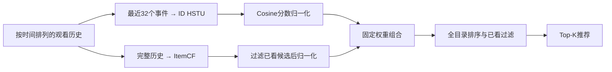

# AgenticRec

基于 **HSTU + ItemCF** 的 MicroLens-50K 视频推荐项目，覆盖数据预处理、参考实现核对、离线评估、误差诊断、实验改进和 HTTP 推荐服务。

当前固定方案保留 HSTU 的序列建模能力，通过 ItemCF 补充协同关联信号。相对纯 ID HSTU，测试集 **NDCG@10 提高 18.72%**；相对已完成的频次修正方案，提高 **8.31%**。服务已在 A100 MIG 上完成评分一致性、核心延迟测量和真实 HTTP 调用检查。

> 状态更新：2026-10-24。结果来自项目负责人回传的服务器输出，完整运行产物保存在服务器。当前证据为单种子、离线实验；测试基准已被多个固定方案使用，未建立统计显著性、线上 CTR/观看时长收益或生产部署能力。

## 项目做了什么

- **统一数据与评估**：确定性的时间排序、可逆 ID 映射、逐用户 leave-one-out，以及共享的全目录 Recall/NDCG 计算。
- **核对 HSTU 实现**：固定官方版本，完成稠密块输出/梯度比较、合成任务拟合、检查点恢复与官方 MovieLens-1M 配方复现。
- **从诊断选择改进**：比较 Popularity、ItemCF、均值池化、纯 ID HSTU、标题特征对照，定位低频目标表现不足，验证两路评分的互补性。
- **固定方案并提供服务**：验证集选择组合权重后固定测试；模型启动时加载一次，提供精确全目录推荐、确定性兜底和模型/数据身份记录。

## 离线效果

### MicroLens-50K 测试集

每个方案在同一数据快照上评估 50,000 个用户目标。排名覆盖全部 19,220 个映射物品，排除 padding 和完整可见历史；同分按映射 ID 升序排列。零训练频次目标保留在分母中。

| 方案 | Recall@10 | NDCG@10 | Recall@20 | NDCG@20 |
|---|---:|---:|---:|---:|
| Popularity | 0.00244 | 0.001254 | 0.00378 | 0.001594 |
| ItemCF | 0.03534 | 0.017473 | 0.05760 | 0.023088 |
| 因果前缀均值池化 | 0.03634 | 0.017816 | 0.05982 | 0.023729 |
| 纯 ID HSTU | 0.04882 | 0.024729 | 0.07238 | 0.030686 |
| HSTU + 固定频次修正 | 0.05174 | 0.027107 | 0.07572 | 0.033161 |
| **HSTU + ItemCF（当前服务配方）** | **0.05610** | **0.029359** | **0.08346** | **0.036262** |

组合相对纯 ID HSTU 的 NDCG@10 / Recall@20 分别提高 **18.72% / 15.31%**；相对频次修正方案分别提高 **8.31% / 10.22%**。这些数值为相对变化，不是百分点。

### 改善了哪些目标

以下按**目标物品在训练历史中的出现次数**分组，统计测试集 Top-20 命中用户数。频次分组用于诊断，服务不会使用未知目标的频次来决定推荐策略。

| 目标训练频次 | 用户数 | 纯 ID HSTU | 频次修正 HSTU | HSTU + ItemCF |
|---|---:|---:|---:|---:|
| 0 | 2,226 | 0 | 0 | 0 |
| 1–5 | 11,557 | 0 | 0 | **86** |
| 6–20 | 19,270 | 153 | 250 | **580** |
| 21+ | 16,947 | 3,466 | **3,536** | 3,507 |
| 全部 | 50,000 | 3,619 | 3,786 | **4,173** |

组合改善了部分低频目标，同时相对频次修正方案损失了少量高频命中。1–5 次组命中率仍只有 **0.744%**，零频组仍为零，因此不能声称已解决长尾或冷启动。

详见[固定组合测试记录](docs/learning-25-frozen-hybrid-test.md)。

## 方案与实验依据



HSTU 使用位置偏置、共享输入/输出 ID 向量和全目录交叉熵训练。ItemCF 使用训练历史构建二值用户–物品余弦相似度，每个物品保留 100 个邻居，查询时聚合完整可见历史的关联分数。

验证集预先限定权重 `{0, 0.1, 0.25, 0.5}`，按“总体 NDCG@10 不退化且低频组有命中，再最大化总体 NDCG@10”的规则选择 **0.25**。最终配方为：

```text
score = 0.75 × (HSTU_cosine + 1) / 2
      + 0.25 × ItemCF_score / max(eligible_ItemCF_scores)
```

CF 无可用信号时回退原始 HSTU；空历史使用训练集热门榜。当前服务不叠加标题或此前的频次修正，排序分数不是点击概率。

| 对照实验 | 观察与决定 |
|---|---|
| 因果前缀均值池化 | 与 HSTU 使用相同的评分头、目标和训练预算；整体弱于 HSTU，但部分低频组更好，保留 HSTU 并继续诊断评分行为 |
| 频次修正 | 仅调整评分，整体指标提高，但 1–5 次目标仍无命中 |
| 标题初始化 / 固定融合 | 使用冻结 MiniLM 特征；初始化测试 NDCG@10=0.025048，未解决低频目标问题，未建立稳定内容收益 |
| 共享标题映射 | 学习映射较固定映射的总体收益主要来自高频组，零频和最低频组反而下降，停止当前配方 |
| HSTU + ItemCF | 诊断发现两路有独有命中；有限验证集组合及固定测试确认了本次单种子收益，选为服务方案 |

这些对照支持当前工程选择，不证明文本特征普遍无效，也不是纯粹的注意力/顺序消融。标题与共享映射分别见[笔记 20](docs/learning-20-title-hstu-controls.md)、[笔记 23](docs/learning-23-shared-title-mapping.md)；组合依据见[机制审计](docs/learning-22-validation-mechanism-audit.md)和[组合验证](docs/learning-24-hybrid-validation.md)。

### 官方实现核对

官方源码固定在 Meta [generative-recommenders](https://github.com/meta-recsys/generative-recommenders/tree/10c4950343b98bacec9ffd5b8cd879f811fe2326) 的 `10c4950343b98bacec9ffd5b8cd879f811fe2326`。

- 12 个稠密块输出/梯度比较用例在服务器通过。
- 合成任务拟合损失下降 99.3%，检查点输出、随机状态及下一步续训检查通过。
- 官方 MovieLens-1M 配方完成 batch=128、101 epochs；6 个最终指标与固定参考的绝对差均小于 0.00374，落在预先声明的 0.02 工程容差内。

这不是统计等价证明。MicroLens 使用位置偏置和全目录交叉熵，官方 ML-1M 配方使用时间偏置及 sampled softmax；两者的数据和协议不同，指标不能直接比较。配置见[参考版本清单](configs/hstu-reference-upstream.json)与[ML-1M 配置](configs/hstu-ml1m-train-server.json)。

## 推荐服务与性能

固定方案提供 `GET /health` 与 `POST /recommend`。服务默认绑定服务器的 `127.0.0.1:8765`，启动时核验数据、配置、源码与检查点身份，加载一次 HSTU 和训练集 ItemCF。

**已验证环境**：Python 3.11.16、PyTorch 2.10.0+cu128、NumPy 1.26.4、A100-SXM4-80GB MIG 2g.20gb（约 19.50 GiB 可见显存）；FP32、TF32 关闭，24 个 Torch CPU 线程。

100 个训练历史样本与原离线批量评分比较：**Top-20 全部一致**，最大分数误差 `2.12e-7`，低于 `1e-6` 阈值。

| 单请求核心延迟 | 原始 HSTU | HSTU + ItemCF |
|---|---:|---:|
| 平均 | 3.354 ms | 3.705 ms |
| p50 | 3.348 ms | 3.612 ms |
| p95 | 3.438 ms | 3.932 ms |
| p99 | 3.546 ms | 4.505 ms |

测量条件：19,220 个候选、batch=1、并发=1，每路预热 20 次、测量 100 次，计时前后 CUDA 同步。范围包含输入校验、推理、GPU→CPU 传输、CF 与排序，**不含 HTTP、排队和启动时间**。组合平均额外耗时约 0.35ms（10.45%）。启动约 11.38s；100 次样本不足以证明稳定生产尾延迟。

两路共享模型与 CF，PyTorch 峰值 allocated/reserved 约 47.48/60 MiB；该数值不包含 CPU 上的 ItemCF 和所有外部分配，不能视为总服务内存。真实健康检查与推荐请求已通过，HTTP 端到端延迟和并发吞吐量尚未测量。

### 在已有服务器产物上运行

以下命令假设已配置环境、数据与原实验报告/检查点。Git 仓库不包含这些运行产物，不能仅克隆后直接启动服务。

```bash
conda activate "$HOME/conda-envs/agenticrec-hstu-reference"
python -m serving.run serve --config configs/hybrid-serving-server.json
```

在同一服务器另一个终端请求：

```bash
curl --fail http://127.0.0.1:8765/health
curl --fail http://127.0.0.1:8765/recommend \
  -H 'Content-Type: application/json' \
  -d '{"history":[1,2,3],"k":10}'
```

`history` 使用 `item_mapping.json` 中的**映射 ID**，按从旧到新排列。返回包含 `items`、`fallback`、`eligible_items`、`model_id` 和 `mode`，推荐会排除已看物品。示例是合成请求，不代表真实用户兴趣。非法 ID 返回 400，空历史返回热门榜。

服务及 benchmark 的完整命令、限制和身份校验依赖见[笔记 26](docs/learning-26-exact-serving.md)。当前实现为本机串行演示服务。

## 数据与复现

### 数据协议

当前快照有 **50,000 用户、19,220 物品、359,708 交互**；完整序列长度均值 7.19、中位数 6。输入为 `data/raw/MicroLens-50k_pairs.csv`，列为 `user,item,timestamp`。

```bash
python -m src.preprocess --min-seq-len 5
```

预处理按用户和时间排序，保留至少 5 次交互的序列，映射物品到连续正整数，0 留给 padding。每个用户最后一个事件为 test、倒数第二个为 val，其余为训练历史。

| `data/processed/` 文件 | 内容 |
|---|---|
| `sequences.jsonl` | 每个用户的 `user_id`、`train`、`val`、`test` |
| `item_mapping.json` | 原始 ID 与映射 ID 的双向转换 |
| `metadata.json` | 预处理配置、统计与源文件校验和 |

训练输入为左补零的移位预测序列；验证只看训练历史，测试可见训练历史加验证物品。模型截断到最近 32 个事件，但排序过滤完整可见历史。逐用户时间顺序成立，**不等价于跨用户全局时间切分**。标题实验需要另行提供标题 CSV；当前固定服务不使用标题特征。

### 执行环境与复现路径

模型、DataLoader、训练和 GPU 验证在 Linux 服务器运行；Mac 用于编辑、预处理、语法和轻量检查。实际 GPU 可能不同于最初计划的 H200，运行前检查分配设备。

环境规格见 [Conda 文件](environments/hstu-reference.yml)和[依赖文件](environments/hstu-reference-requirements.txt)。新环境先用[准备脚本](scripts/prepare_hstu_reference.py)检查 Python/Conda/Torch/CUDA，再规划安装；不要从驱动显示的 CUDA 能力推断已安装运行时。

| 复现阶段 | 入口或说明 |
|---|---|
| 数据与共享评估 | [Dataset](src/data/dataset.py)、[指标实现](src/evaluation.py)、[基线说明](docs/learning-04-evaluation-and-baselines.md) |
| MicroLens HSTU | [接入与检查](docs/learning-11-microlens-hstu.md)、[完整训练](docs/learning-12-microlens-full-training.md) |
| 诊断与控制实验 | [均值池化](docs/learning-17-prefix-mean-control.md)、[标题特征](docs/learning-19-frozen-title-features.md)、[机制审计](docs/learning-22-validation-mechanism-audit.md) |
| 固定组合 | [验证集组合](docs/learning-24-hybrid-validation.md)、[冻结测试](docs/learning-25-frozen-hybrid-test.md) |
| 服务与性能 | [接口、正确性与测量](docs/learning-26-exact-serving.md) |

全新复现需要依次生成数据、训练基线与模型、完成验证选择，再运行固定评估和服务；现有准入配置引用原始时间戳路径，新运行应显式配置对应产物，不能关闭哈希校验来跳过依赖。

已有产物环境可执行服务检查：

```bash
python -m unittest tests.test_serving tests.test_serving_torch -v
python -m serving.run benchmark --config configs/hybrid-serving-server.json
```

服务器已通过 7 个服务聚焦测试及该 benchmark。已有验证结果无需为文档更新重复运行。

### 实验产物

配置、代码、测试和说明通过 Git 同步；原始/处理后数据、物理环境、日志、缓存和检查点不提交。正式运行记录 Git、配置、种子、数据校验和、实际设备及相关版本；服务还记录模型身份与来源文件哈希。检查点采用 `state_dict`，产物在忽略的 `runs/` 下。

| 已完成运行 | `runs/` 下的目录 |
|---|---|
| 纯 ID HSTU 训练 | `hstu-microlens/20261022T023420952080Z/` |
| 固定组合验证 | `hybrid-validation/20261024T203229829396Z/` |
| 固定组合测试 | `hybrid-selected-test/20261024T204032578400Z/` |
| 服务一致性与延迟 | `hybrid-serving/20261024T204850491181Z/` |

## 代码结构

```text
src/data/         时序 Dataset 与 DataLoader
src/models/       可移植稠密 HSTU 块与纯 ID 模型
src/preprocess.py 数据预处理
src/evaluation.py 统一全目录排名与指标
src/baselines.py  Popularity / ItemCF
controls/         因果前缀均值池化对照
content_hstu/     标题初始化与固定融合对照
mapped_hstu/      共享标题映射对照
title_features/   标题对齐、冻结编码与缓存校验
diagnostics/      机制诊断、统计与产物准入
serving/          请求校验、模型加载、HTTP 与核心性能测量
scripts/          环境准备、实验审计与固定评估入口
configs/          实验与设备配置
tests/            数据、指标、模型与服务聚焦检查
docs/             教学笔记、实验决策与验证记录
```

## 当前边界与后续工作

已完成固定方案的离线评估与本机 HTTP 演示。尚未验证多种子稳定性、全局时间回放、HTTP 并发性能或线上收益；没有完整 SASRec 对照，因此不声称优于 SASRec。标题实验的负结果限于当前配方。Agents 不在当前实现范围，MiniOneRec 等模型仅作为阅读参考。

后续优先整理可分享的实验产物与演示，并按实际需要补充端到端服务测量和稳定性验证；当前规模已有精确评分结果，暂不引入未经测量支持的 ANN 或新骨干。
