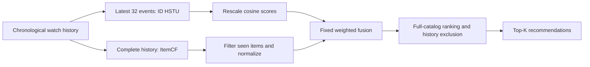

# RecPilot

An **HSTU + ItemCF** video recommendation project on MicroLens-50K, covering data preprocessing, reference implementation checks, offline evaluation, error diagnosis, controlled experiments, and an HTTP recommendation service.

The frozen recipe combines HSTU's sequential representations with ItemCF's collaborative signals. Test **NDCG@10 improves by 18.72%** over pure-ID HSTU and **8.31%** over the fixed frequency-corrected baseline. Scoring parity, core latency, and live HTTP calls have been verified on an A100 MIG allocation.

> Updated: 2026-11-07. Results are based on server outputs returned by the project owner; full artifacts remain on the server. Evidence is limited to single-seed offline experiments on a benchmark reused across several frozen recipes. Statistical significance, online CTR/watch-time gains, and production readiness have not been established.

## What This Project Delivers

- **Shared data and evaluation contracts:** deterministic chronological ordering, reversible item mappings, per-user leave-one-out splits, and full-catalog Recall/NDCG.
- **HSTU implementation checks:** a pinned upstream revision, dense-block output/gradient comparisons, synthetic fitting, checkpoint restoration, and the official MovieLens-1M recipe.
- **Evidence-driven improvements:** Popularity, ItemCF, mean pooling, pure-ID HSTU, and title-feature controls to diagnose sparse-target failures and measure complementary scoring signals.
- **A frozen serving recipe:** validation-selected fusion weights, fixed test evaluation, exact full-catalog recommendations, deterministic fallbacks, and model/data identity tracking.

## Offline Results

### MicroLens-50K Test Set

Each recipe evaluates 50,000 user targets on the same data snapshot. Ranking covers all 19,220 mapped items, excludes padding and the user's complete visible history, and resolves score ties by ascending mapped item ID. Targets with zero training-history occurrences remain in the evaluation denominator.

| Recipe | Recall@10 | NDCG@10 | Recall@20 | NDCG@20 |
|---|---:|---:|---:|---:|
| Popularity | 0.00244 | 0.001254 | 0.00378 | 0.001594 |
| ItemCF | 0.03534 | 0.017473 | 0.05760 | 0.023088 |
| Causal prefix mean pooling | 0.03634 | 0.017816 | 0.05982 | 0.023729 |
| Pure-ID HSTU | 0.04882 | 0.024729 | 0.07238 | 0.030686 |
| HSTU + fixed frequency correction | 0.05174 | 0.027107 | 0.07572 | 0.033161 |
| **HSTU + ItemCF (current serving recipe)** | **0.05610** | **0.029359** | **0.08346** | **0.036262** |

The hybrid improves NDCG@10 / Recall@20 by **18.72% / 15.31%** over pure-ID HSTU and **8.31% / 10.22%** over frequency-corrected HSTU. These are relative changes, not percentage-point differences.

### Which Targets Benefit?

The table counts test users whose target appears in the Top 20, grouped by **target-item occurrences in training histories**. These groups are diagnostic; serving never uses the unknown target's frequency to choose a recommendation strategy.

| Target training frequency | Users | Pure-ID HSTU | Frequency-corrected HSTU | HSTU + ItemCF |
|---|---:|---:|---:|---:|
| 0 | 2,226 | 0 | 0 | 0 |
| 1–5 | 11,557 | 0 | 0 | **86** |
| 6–20 | 19,270 | 153 | 250 | **580** |
| 21+ | 16,947 | 3,466 | **3,536** | 3,507 |
| All | 50,000 | 3,619 | 3,786 | **4,173** |

The hybrid improves some sparse targets while losing a small number of frequent-target hits relative to frequency correction. Recall@20 in the 1–5 group is still only **0.744%**, and zero-frequency targets still receive no hits. Long-tail recommendation and cold start remain unresolved.

## Approach and Experimental Rationale



HSTU uses positional bias, tied input/output ID embeddings, and full-catalog cross entropy. ItemCF builds binary user-item cosine similarities from training histories, retains 100 neighbors per item, and aggregates neighbor scores over the complete visible query history.

A predeclared validation grid `{0, 0.1, 0.25, 0.5}` selected **0.25**: require no overall NDCG@10 regression against raw HSTU and at least one hit in the 1–5 frequency group, then maximize overall validation NDCG@10. The frozen recipe is:

```text
score = 0.75 * (HSTU_cosine + 1) / 2
      + 0.25 * ItemCF_score / max(eligible_ItemCF_scores)
```

When CF has no eligible signal, scoring falls back to raw HSTU. Empty histories use training popularity. The current service adds neither titles nor the earlier frequency correction. Ranking scores are not click probabilities.

| Control | Observation and decision |
|---|---|
| Causal prefix mean pooling | Same scoring head, objective, and training budget as HSTU; weaker overall but better on some sparse-target groups. Retain HSTU and investigate scoring behavior. |
| Frequency correction | Improves overall metrics through scoring alone; still no hits for frequency 1–5 targets. |
| Title initialization / fixed fusion | Uses frozen MiniLM features. Initialization reaches test NDCG@10=0.025048 but does not solve sparse-target failures; stable content gains are unproven. |
| Shared title mapping | Gains from learning the mapping mainly come from frequent targets; zero-frequency and lowest-frequency groups decline. Stop this recipe. |
| HSTU + ItemCF | Diagnostics identify exclusive hits in both channels. Bounded validation fusion and frozen test evaluation show a single-seed gain; select this recipe for serving. |

These controls support the current engineering decision. They do not establish that text features are generally ineffective or isolate attention/order as the cause of gains.

### Upstream Implementation Checks

Meta's [generative-recommenders](https://github.com/meta-recsys/generative-recommenders/tree/10c4950343b98bacec9ffd5b8cd879f811fe2326) is pinned at `10c4950343b98bacec9ffd5b8cd879f811fe2326`.

- Twelve dense-block output/gradient comparison cases passed on the server.
- Synthetic fitting reduced loss by 99.3%; checkpoint output, RNG restoration, and next-step continuation checks passed.
- The official MovieLens-1M recipe completed 101 epochs at batch size 128. All six final metric differences from the pinned reference are below 0.00374, within the predeclared 0.02 absolute engineering tolerance.

This does not establish statistical equivalence. MicroLens uses positional bias and full-catalog cross entropy; the official ML-1M recipe uses temporal bias and sampled softmax. Their datasets and protocols differ, so scores are not directly comparable. See the [upstream manifest](configs/hstu-reference-upstream.json) and [ML-1M configuration](configs/hstu-ml1m-train-server.json).

## Recommendation Service and Performance

The frozen recipe exposes `GET /health` and `POST /recommend`. The service binds to `127.0.0.1:8765` on the server, authenticates data/config/source/checkpoint identities at startup, and loads HSTU and training-only ItemCF once.

**Verified environment:** Python 3.11.16, PyTorch 2.10.0+cu128, NumPy 1.26.4, A100-SXM4-80GB MIG 2g.20gb (approximately 19.50 GiB visible memory), FP32, TF32 disabled, and 24 Torch CPU threads.

Against the original offline batched scorer, 100 training-history samples produced **identical Top-20 rankings**, with maximum score error `2.12e-7`, below the `1e-6` threshold.

| Core request latency | Raw HSTU | HSTU + ItemCF |
|---|---:|---:|
| Mean | 3.354 ms | 3.705 ms |
| p50 | 3.348 ms | 3.612 ms |
| p95 | 3.438 ms | 3.932 ms |
| p99 | 3.546 ms | 4.505 ms |

Conditions: 19,220 candidates, batch size 1, concurrency 1, 20 warmup requests and 100 measured requests per mode, with CUDA synchronization around each timed request. Timing includes input validation, inference, GPU-to-CPU transfer, CF scoring, and ranking; it **excludes HTTP, queueing, and startup**. Mean hybrid overhead is approximately 0.35 ms (10.45%). Startup takes approximately 11.38 s. A 100-request sample does not establish stable production tail latency.

Both modes share the loaded model and CF. Peak PyTorch allocated/reserved memory is approximately 47.48/60 MiB; this excludes CPU ItemCF storage and some external allocations and is not total service memory. Live health and recommendation calls passed. Subsequent HTTP load measurements are summarized below; they do not change the scope of this earlier core-only benchmark.

### HTTP Load Baseline (2026-11-07)

Eight returned 60-second loopback load reports were checked against their raw
samples. With scheduled arrivals at 200/s, all 12,000 requests succeeded with
no client drops; successful HTTP p99 was 18.05 ms. At 400 scheduled arrivals/s,
successful window throughput fell to 193.87 QPS, 12,210 of 24,000 arrivals were
client-dropped and 134 attempted requests failed. Successful HTTP p99 reached
3.098 seconds. Drops occurred in the bounded client, not as server overload
responses. The server currently processes requests serially.

Closed concurrency 4 reached 243.58 successful QPS with no errors. At concurrency
32, 1.995% of attempts failed: success-only p99 was 36.93 ms, whereas p99 of time
to success **or failure** was 5.005 seconds. This distinction matters for tail
latency reporting. These are single-run observations, not a sustainable capacity
or availability guarantee. The workload/model identity matches the core report;
HTTP client reports do not independently record server hardware utilization.

See [complete load results, operator evidence and next experiment](benchmarks/RESULTS-2026-11-07.md).

### Run with Existing Server Artifacts

These commands assume the environment, data, and original experiment reports/checkpoints are available. Runtime artifacts are not in Git; cloning alone is insufficient to start the service.

```bash
conda activate "$HOME/conda-envs/agenticrec-hstu-reference"
python -m serving.run serve --config configs/hybrid-serving-server.json
```

From another terminal on the same server:

```bash
curl --fail http://127.0.0.1:8765/health
curl --fail http://127.0.0.1:8765/recommend \
  -H 'Content-Type: application/json' \
  -d '{"history":[1,2,3],"k":10}'
```

`history` contains **mapped IDs** from `item_mapping.json`, ordered oldest to newest. Responses include `items`, `fallback`, `eligible_items`, `model_id`, and `mode`; seen items are excluded. This synthetic request does not represent a real user's preferences. Invalid IDs return HTTP 400; empty histories return popularity recommendations.

The current implementation is a local sequential demonstration service. Artifact paths and request limits are configured in [the serving configuration](configs/hybrid-serving-server.json).

## Data and Reproduction

### Data Contract

The current snapshot contains **50,000 users, 19,220 items, and 359,708 interactions**. Full sequence length has mean 7.19 and median 6. Input is `data/raw/MicroLens-50k_pairs.csv`, with columns `user,item,timestamp`.

```bash
python -m src.preprocess --min-seq-len 5
```

Preprocessing sorts by user and timestamp, retains sequences with at least five interactions, maps items to contiguous positive integers, and reserves 0 for padding. For each user, the last event is test, the penultimate event is validation, and all earlier events form training history.

| File in `data/processed/` | Contents |
|---|---|
| `sequences.jsonl` | Per-user `user_id`, `train`, `val`, and `test` |
| `item_mapping.json` | Bidirectional original/mapped item-ID conversion |
| `metadata.json` | Preprocessing configuration, statistics, and source checksum |

Training uses left-padded, shifted next-item sequences. Validation sees training history; test sees training history plus the validation item. The model retains the latest 32 events, while ranking filters the complete visible history. This preserves per-user chronology; **it is not a global-time split across users**. Title experiments require a separately supplied title CSV; the frozen service does not use title features.

### Environments and Reproduction Path

Model, DataLoader, training, and GPU validation run on the Linux server. The Mac is used for editing, preprocessing, syntax checks, and lightweight tests. Inspect the actual assigned GPU before execution; it may differ from the originally planned H200.

Environment specifications are in the [Conda file](environments/hstu-reference.yml) and [requirements file](environments/hstu-reference-requirements.txt). For a new environment, use the [preparation script](scripts/prepare_hstu_reference.py) to inspect Python/Conda/Torch/CUDA before planning installation. The driver's reported CUDA capability does not identify the installed runtime.

| Stage | Entry points |
|---|---|
| Data and shared evaluation | [Dataset](src/data/dataset.py), [metrics](src/evaluation.py), [baselines](src/run_baselines.py) |
| MicroLens HSTU | [Training and evaluation](src/run_hstu_microlens.py), [configuration guide](configs/README.md) |
| Diagnostics and controls | [Mean pooling](controls/run_mean_pooling.py), [title features](scripts/prepare_title_features.py), [mechanism audit](scripts/audit_recommendation_mechanisms.py) |
| Frozen hybrid | [Validation fusion](scripts/evaluate_hybrid_validation.py), [frozen test](scripts/evaluate_selected_hybrid.py) |
| Serving and performance | [Service entry point](serving/run.py), [benchmark](serving/benchmark.py) |

A fresh reproduction must generate data, train baselines/models, complete validation selection, and then run fixed evaluation and serving. Existing admission configurations reference original timestamped artifacts. New runs must explicitly configure their corresponding artifacts rather than disable hash checks to bypass dependencies. Teaching notes and the development test suite are maintained locally and are not included in this checkout.

With existing artifacts, run the serving checks:

```bash
python -m serving.run benchmark --config configs/hybrid-serving-server.json
```

All seven focused serving tests and the benchmark passed on the server. Documentation updates do not require repeating completed experiments.

### Experiment Artifacts

Runtime code, configurations, environment specifications, and repository README files are synchronized through Git. Assistant instructions, teaching notes (`docs/`), and development tests (`tests/`) are retained locally and excluded from future commits. Raw/processed data, physical environments, logs, caches, and checkpoints are excluded. Formal runs record Git state, configuration, seed, data checksums, actual hardware, and relevant versions. Serving also records model identity and source-file hashes. Checkpoints use `state_dict`; outputs live under ignored `runs/` directories.

| Completed run | Directory under `runs/` |
|---|---|
| Pure-ID HSTU training | `hstu-microlens/20261022T023420952080Z/` |
| Frozen hybrid validation | `hybrid-validation/20261024T203229829396Z/` |
| Frozen hybrid test | `hybrid-selected-test/20261024T204032578400Z/` |
| Serving parity and latency | `hybrid-serving/20261024T204850491181Z/` |

## Repository Layout

```text
src/data/         Sequential Dataset and DataLoader
src/models/       Portable dense HSTU blocks and pure-ID model
src/preprocess.py Data preprocessing
src/evaluation.py Shared full-catalog ranking and metrics
src/baselines.py  Popularity and ItemCF
controls/         Causal prefix-mean control
content_hstu/     Title initialization and fixed-fusion controls
mapped_hstu/      Shared title-mapping controls
title_features/   Title alignment, frozen encoding, and cache verification
diagnostics/      Mechanism diagnostics, statistics, and artifact admission
serving/          Frozen serial HTTP baseline, model loading and core benchmarks
scheduled_serving/ Bounded request scheduling, deadlines and per-point telemetry
scripts/          Environment preparation, audits, and frozen evaluation
configs/          Experiment and device configurations
environments/     Reproducible environment specifications
third_party/      Upstream license notices
```

## Limitations and Next Steps

At 200 offered requests/s on an A100 MIG 2g.20gb, the reusable HTTP handler pool served 12,000/12,000 requests in each of two rounds. Successful HTTP p99 was 12.46 and 13.54 ms. Of four configurations, only the handler pool with per-connection timers met the 20 ms target in both rounds. At 400 offered requests/s, pooling with a shared timer led both rounds at 214.98 and 218.42 successful requests/s. With 32 closed-loop clients, every bounded transport delivered less than one successful response/s within each measurement window. See the [200/s measurements](scheduled_serving/README.md#server-results-at-200-requests-per-second) and [overload results](scheduled_serving/README.md#server-results-under-overload). With 32 closed-loop clients honoring Retry-After, the handler pool delivered 213.63 and 213.98 successful responses/s with zero late results discarded. Mean queue residence remained about 73 ms. See the [pacing measurements](scheduled_serving/README.md#measured-effect-of-honoring-retry-after) and the [queue capacity results](scheduled_serving/README.md#queue-capacity-results). With four waiting slots, overload p99 fell to 42–43 ms and queue-full refusals rose from 900 to 1,620 per round. Neither depth met the full 200/s target in this repeat.

The frozen recipe has completed offline evaluation and a local HTTP demonstration. Multi-seed robustness, global-time replay, production availability and online gains remain unverified. Initial HTTP concurrency measurements are complete and expose overload failures. There is no full SASRec comparison, so no superiority over SASRec is claimed. Negative title results apply to the tested recipes. Agents are outside the current implementation scope; MiniOneRec and related models remain reading references.

An isolated performance baseline is now implemented in [benchmarks/](benchmarks/README.md): plain core timing, training-stage attribution, CPU/CUDA traces, and closed/open-loop HTTP load. Lightweight local checks passed. Both core benchmark entry points returned server PASS on 2026-11-07; the returned JSON reports show 3.749 ms mean core serving latency and 10,163 effective supervised positions/s in the disposable training window on A100 MIG 2g.20gb. Both operator tables and all eight real-service HTTP load reports have been inspected; raw trace timelines remain uninspected. The initial performance baseline is complete. The next experiment is implemented in [scheduled_serving/](scheduled_serving/README.md): a bounded queue, one inference worker, accept-time deadlines, explicit overload handling and per-point queue/core telemetry. Seventeen lightweight local checks passed. Server verification subsequently confirmed exact direct-vs-scheduled responses for 101 requests and clean shutdown; all eight scheduled load points have been verified. At 200 arrivals/s the serial and scheduled success rates were 100% and 98.64%. At 400/s successful HTTP p99 fell from 3.10 s to 156 ms while offered success fell from 48.57% to 39.03%. See the [paired measurements](scheduled_serving/RESULTS-2026-11-08.md). Batching remains a separate future comparison. Possible later work includes shareable experiment artifacts and robustness checks. Exact scoring is already measured at the current catalog size; ANN or a new backbone would require additional evidence.
